# GlassRemote — Product Exploration and Engineering Audit

| | |
|---|---|
| Audited revision | `29afcbc` on `Phase-9-gap-fixes` (PR #8 → `Phase-9`), "Docs: Connection settings text and comments describe the restored volume routes…" |
| Audit date | 2026-11-12 |
| Auditor environment | Linux cloud sandbox. **No Xcode, no iOS Simulator, no iPhone, no Android TV box, no Samsung TV, no soundbar, no Nuvio account.** |
| Evidence available | Full source and docs; GitHub Actions run `43253199439` for this exact commit (simulator build + 540 unit tests, Release device build, unsigned IPA, simulator page renders, logs) |
| Code changes made | None. This report and the `audit/` folder are the only additions. |

> **Read this first: what kind of audit this is.** The brief asks for hands-on exploration first. That was not possible here: the sandbox has no macOS, simulator or hardware. **Nothing in this report is "Hands-on verified".** The evidence labels used throughout are:
>
> - **Automated** — proven by the CI run for `29afcbc` (build, unit test, or a simulator render the test suite produced). Renders are *simulator fixtures with stubbed state*, not real-device behaviour.
> - **Source-reviewed** — read and traced in the code; the mechanism is confirmed but was not exercised.
> - **Hypothesis** — the code makes the problem likely, but whether it happens depends on iOS/Android runtime behaviour that must be checked on a device.
> - **Not testable** — needs hardware, an account, or a network that was not available.
>
> The exploration diary (§4) records honestly what was actually done. Section 19 is the physical test plan that should run before any of the hypotheses are treated as confirmed.

---

## Contents

1. Executive summary and findings table
2. Audit scope and environment
3. What GlassRemote is
4. Exploration diary
5. Screen-by-screen review
6. Portrait and landscape comparison
7. Universal app compatibility
8. Interaction and usability audit
9. Visual design audit
10. Performance and responsiveness
11. Reliability, connectivity and recovery
12. Nuvio and the media ecosystem
13. Accessibility, privacy and security
14. What is already excellent
15. Confirmed bugs and defects
16. UX and design improvements
17. Quality-of-life and new feature ideas
18. Architecture and maintainability
19. Testing gaps and proposed regression matrix
20. Prioritised recommendations
21. Final-product readiness assessment
22. Answers to the twenty product questions
23. Appendix

---

## 1. Executive summary

**Overall judgement.** GlassRemote is a careful, unusually honest piece of engineering wrapped in a polished, coherent shell. The design discipline shows: an explicit device selector with no cross-device fallback, a volume output that refuses rather than silently re-routes (with one exception, below), a Now Playing screen that never invents a duration or scrubber, shell quoting that is genuinely safe, and secrets kept out of logs and out of the saved add-on list. It is close to finished. What stands between it and "finished" is not architecture or visual design. It is **input edge cases that only appear under real touch interruption**, **two volume-state bugs on the relative routes**, a handful of **state-honesty gaps** (the header says *Connected* when input is dead; failures that never reach the screen the user is looking at), and **almost no physical-device evidence** for anything shipped in Phase 9.

**Strongest areas.**
- Routing discipline: one explicit target device, no silent fallback between Android box and Samsung TV (`RemoteRouting.swift`), tested.
- Default volume route ("Soundbar, through the TV box") is wired correctly end to end and refuses with a reason when the box is down.
- Now Playing honesty: controls follow advertised session actions; no duration, no scrubber, seek relabelled only by measured evidence (`Seeking.swift`, `PlayerPolicy.swift`).
- Security hygiene: two-layer shell quoting with an allow-list (`TVShell.quote`, `shellSafeURL`), Keychain storage for ADB identity, Samsung token, Nuvio session and add-on links, typed text redacted from logs.
- Reduce Motion is handled thoroughly through shared motion tokens.

**Biggest risks (ranked by user impact).**
1. **Volume can move the wrong way or jump on the relative routes** (BUG-001, BUG-002). The Remote slider and the Now Playing slider each keep their own position but share one assumed level. Nudging one after using the other can send several presses in the *opposite* direction. This affects the default soundbar route. *Source-reviewed, confirmed mechanism.*
2. **Touch-interruption bugs in the remote surface** (BUG-006, BUG-007, BUG-008). A held D-pad key has no cancellation path except normal lift, so Control Center, a notification or a call may leave it repeating. Two-finger tap and scroll are recognised on the *root* view, so they may send Back or scroll to the TV while the user is on Discover or Profile. A mouse drag may leave the TV's virtual mouse button held. *Mechanisms confirmed in source; runtime behaviour is a hypothesis.*
3. **"TV speakers" output silently switches to TV remote keys** after three UPnP failures (BUG-003). Those keys reach whatever the TV is outputting to. This contradicts the product's own "never silently switch outputs" rule, though it is documented in the README and enshrined in a test.
4. **"Connected" does not mean "the remote works"** (UX-001). The header is driven by the ADB link alone; if the keyboard or mouse helper failed, D-pad presses are dropped with a status string the Remote page doesn't show.
5. **Universal compatibility is narrower than the product promise** (UX-004). Only nine hard-coded apps can be launched, all via `monkey`; there is no Settings, Stremio or browser tile, and holding OK auto-repeats Enter instead of producing a long-press (BUG-009), which matters in YouTube and the Android TV home screen.

**Readiness.** *Feature-complete beta.* Release-ready after: the Now items in §20 (about 2–3 developer-weeks), one structured physical-device pass using §19, and documentation reconciled with the code (§18.4).

### Findings summary

Severity follows the brief: Critical = security loss, wrong-device/output control, core path broken; High = major workflow broken or serious barrier; Medium = meaningful friction; Low = minor; Polish = refinement. **No finding is rated Critical**: no path was found that sends input or volume to the wrong *device*, and no secret leaks.

| ID | Title | Severity | Evidence / confidence | Priority |
|---|---|---|---|---|
| BUG-001 | Remote and Now Playing volume sliders keep separate positions over one assumed level; a nudge can send presses in the wrong direction | High | Source-reviewed, mechanism confirmed | Now |
| BUG-002 | Assumed volume level resets to 50% on unrelated Samsung/UPnP state changes, so the next touch jumps | Medium | Source-reviewed | Now |
| BUG-003 | "TV speakers" silently falls back from UPnP to TV remote keys | High | Source-reviewed; real-world impact needs hardware | Now |
| BUG-004 | Changing the Samsung address moves UPnP but leaves the remote socket on the old TV | Medium | Source-reviewed | Now |
| BUG-005 | Fresh install defaults to a hard-coded developer LAN address with the Samsung link on | Medium | Source-reviewed | Now |
| BUG-006 | Two-finger tap/scroll recogniser lives on the root view and may act from hidden pages | High | Hypothesis (strong source evidence) | Now |
| BUG-007 | Held D-pad key has no cancellation path; may repeat after a system interruption | High | Hypothesis (strong source evidence) | Now |
| BUG-008 | Mouse pad has no cancellation path; TV mouse button can stay held, next touch can jump | Medium | Hypothesis / source-reviewed | Now |
| BUG-009 | Holding OK auto-repeats Enter; there is no long-press | Medium | Source-reviewed | Now |
| BUG-010 | TV-side input listener (loopback) has no authentication; newest connection wins | Medium | Source-reviewed | Next |
| BUG-011 | Media parser drops transient playback states, briefly showing "Nothing playing" | Medium | Source-reviewed; frequency needs device | Next |
| BUG-012 | Stream picker ignores the tapped / resume episode and opens the season's first episode | Medium | Source-reviewed | Now |
| BUG-013 | Nuvio sign-out races an in-flight refresh; can show signed-in or rewrite tokens | Medium | Source-reviewed | Next |
| BUG-014 | After a device restore, add-ons look installed but return no streams | Medium | Source-reviewed (restore scenario inferred) | Next |
| BUG-015 | Mouse pad, D-pad wedge and selector bubble can stay visually "pressed" after cancellation | Low | Hypothesis | Next |
| BUG-016 | "Restart launcher" always reports success | Low | Source-reviewed | Later |
| BUG-017 | Nuvio link outcome check matches the substring "error" (e.g. search "terror") | Low | Hypothesis | Later |
| BUG-018 | One failed Cinemeta search request (movies or series) discards the other's results | Low | Source-reviewed | Later |
| BUG-019 | Live typing silently truncates input over 400 characters | Low | Source-reviewed | Later |
| BUG-020 | Keyboard status promises an "ADB fallback" that no longer exists; failed live text is lost | Low | Source-reviewed | Next |
| BUG-021 | HTTP 401 from Nuvio never forces a token refresh | Low | Source-reviewed | Later |
| BUG-022 | Detail page shows "Continue on the TV" even after a failed handoff | Low | Source-reviewed | Next |
| BUG-023 | BACK/HOME use a different queue from the D-pad and can overtake it | Low | Hypothesis | Later |
| UX-001 | "Connected" header hides failed keyboard/mouse helpers | Medium | Source-reviewed + Automated render | Now |
| UX-002 | Relative volume routes draw a filled bar that looks like a real level | Medium | Source-reviewed + Automated render | Next (owner decision) |
| UX-003 | Volume row never names its output | Medium | Source-reviewed + Automated render | Now |
| UX-004 | App launching limited to nine hard-coded packages via `monkey`; no Settings/Stremio/browser | Medium | Source-reviewed | Next |
| UX-005 | Failed transport commands are invisible on Now Playing and the mini-player | Medium | Source-reviewed | Now |
| UX-006 | Up to ~10 s of stale Now Playing after returning to the app | Medium | Source-reviewed | Now |
| UX-007 | Paused sessions left behind by an exited app keep the mini-player up indefinitely | Medium | Hypothesis | Next |
| UX-008 | First upward sweep on the Samsung-keys route can send ~100 VOLUP presses | Medium | Source-reviewed | Now |
| UX-009 | Continue Watching refreshes once per launch | Medium | Source-reviewed | Next |
| UX-010 | Live search saves partial queries to Recent searches | Low | Source-reviewed | Next |
| UX-011 | Handoff results land at the bottom of Discover; See All details lose the "back to remote" path | Low | Source-reviewed | Next |
| UX-012 | Mouse/D-pad selector switches on touch-down; hit height 40–42 pt | Low | Hypothesis | Later |
| UX-013 | Now Playing timeline track is always empty; grabber looks draggable but isn't | Low | Source-reviewed + Automated render | Next |
| UX-014 | Unknown apps labelled by package suffix; idle hint names only Nuvio | Low | Source-reviewed | Later |
| UX-015 | ADB authorisation failure isn't explained; retries forever | Low | Source-reviewed | Next |
| UX-016 | "Soundbar max volume" reads as if it affects the default route | Low | Source-reviewed | Later |
| UX-017 | Add-on swipe-to-delete has no confirmation; genre chips under "All" always open movies | Low / Polish | Source-reviewed | Later |
| VIS-001 | Header controls appear ghosted inside the trackpad's top edge in renders | Low | Automated render; cause unconfirmed | Later |
| A11Y-001 | Mouse trackpad has no VoiceOver actions | Medium | Source-reviewed | Next |
| A11Y-002 | Now Playing secondary text is below 4.5:1; no Increase Contrast path | Medium | Source-reviewed (computed) | Next |
| A11Y-003 | Discover hero keeps auto-advancing under VoiceOver | Medium | Source-reviewed | Next |
| A11Y-004 | Dynamic Type gaps (dock icon, landscape cap, 22 fixed sizes) | Low | Partly hypothesis | Later |
| A11Y-005 | Watch progress and artwork titles not announced; no escape action on Now Playing | Low | Source-reviewed | Later |
| A11Y-006 | In-app Reduce Motion is per-profile and not copied to new profiles | Low | Source-reviewed | Later |
| PERF-001 | Every media poll republishes `media` while a session is active | Low | Source-reviewed | Later |
| PERF-002 | UPnP polls every 3 s even when "TV speakers" isn't selected | Low | Source-reviewed | Later |
| PERF-003 | Stream picker renders all rows eagerly | Low | Hypothesis | Later |
| PERF-004 | Add-on response cap applied after the full download; details not cached | Low | Source-reviewed | Later |
| SEC-001 (as BUG) | Samsung TLS accepts any certificate for the configured IP; token sent as URL query | Medium | Source-reviewed | Next |
| SEC-002 | Keyboard history (last 8 strings, possibly passwords) in plain UserDefaults | Low | Source-reviewed | Next |
| SEC-003 | Keychain writes ignore failure status; one Samsung token slot | Low | Source-reviewed | Next |
| SEC-004 | Nuvio backend URL picked by regex from `config.js` | Low | Hypothesis | Later |
| ARCH-001 | Docs contradict code in many places (Now Playing card, ADB volume path, themes menu, swipe direction…) | Medium | Source-reviewed | Now |
| ARCH-002 | Dead code still compiled (`NowPlayingSheet`, pager infrastructure, `DeviceInfoSheet`, dead routing rule) | Low | Source-reviewed | Next |
| ARCH-003 | Mouse helper and cursor JAR are committed binaries without source; bridge is 32-bit only | Medium | Source-reviewed | Next |
| ARCH-004 | Per-box state (ABI, helper revision) stored app-wide; TV helpers never removed | Low | Source-reviewed | Later |
| ARCH-005 | Tests are unit-only, phase-named; renders uploaded but never compared; no UI tests | Medium | Automated (CI config) | Next |
| ARCH-006 | Very large mixed-purpose files; Swift 5 language mode; regex patching of SwiftADB | Low | Source-reviewed | Later |
| ARCH-007 | Asset catalog has nine imagesets nested inside `retroarch_light.imageset` | Low | Source-reviewed | Later |
| FEATURE-001…012 | See §17 | Polish | Ideas | Mixed |

---

## 2. Audit scope and environment

**Actually available**
- Repository checkout at `29afcbc` (detached at PR #8 head). Working tree was clean before the audit and only the report and `audit/` were added.
- `gh` CLI read access: PR #8 metadata and the CI run for this commit.
- CI run `43253199439` (2026-11-12 15:56 UTC, conclusion **success**), three jobs:
  - *Simulator build and unit tests* (macOS 26 runner, iPhone simulator): **540 tests executed, 0 failures**. 8 compiler warnings (3 deprecated `Text +` in `DiscoverHero.swift:174`; 4 unused results of `setHost/setPort/setKeyPair/setDeviceName` at `RemoteModel.swift:320–323`; 1 needless `await` at `VirtualKeyboard.swift:179`).
  - *Helpers, physical iPhone build and IPA*: success (NDK helper compile, Release build, unsigned IPA).
  - *CI timing and PR report*: success.
- CI artifacts downloaded: `glassremote-nowplaying-screens` (15 simulator renders), `ci-logs-test`.
- Read in full: `README.md`, `NUVIO_MIGRATION.md`, `SEEKING_REPORT.md`, `REGRESSION_CHECKLIST.md`, `PHASE-7-NOTES.md` (by sub-reviewers), the PR #8 description, `project.yml`, `.github/workflows/ios-build.yml`, and every Swift and C source file in `GlassRemote/` (≈20k lines) plus the relevant tests (≈8k lines). Reading was split into five subsystem passes (connectivity/input, volume/Samsung, Now Playing/media, Discover/Nuvio/add-ons, shell/UI/profiles/tests), and the high-severity claims were re-checked directly against the source (see Appendix A).

**Not available (and therefore not tested)**
- iPhone hardware or simulator interaction; therefore no tapping, swiping, typing, rotating, VoiceOver, Dynamic Type, or Instruments profiling.
- ARRIS VIP7802 / Android TV box, Samsung TV, soundbar/HDMI-CEC chain.
- YouTube, Nuvio, Stremio, Netflix, Android Settings, browsers on a TV.
- Nuvio account, Stremio add-on endpoints, Cinemeta network calls.

**iOS / platform**: deployment target iOS 26.0 (`project.yml`); SwiftADB pinned to revision `1044bec`; Swift language mode 5.0.

---

## 3. What GlassRemote is

**Purpose.** A native iPhone remote for one Android TV box (ARRIS VIP7802 with Glass Launcher) plus a Samsung TV, with media discovery layered on top. It aims to replace the physical remotes entirely: D-pad and trackpad navigation, keyboard entry, app launching, a dedicated volume output, a Now Playing view, and a Discover catalogue that hands titles to Nuvio or the TV's default player.

**Target user.** Today, effectively one household with a known hardware chain (box → HDMI-CEC → soundbar, Samsung TV). Many choices (hard-coded app list, default Samsung address, single box host, 32-bit-only mouse bridge) reflect that. A "finished product" decision is whether the target remains this household or any Android TV owner; several recommendations below are cheap either way, a few only matter for the second.

**Universal remote role.** All navigation input is OS-level, not app-specific: arrows and OK are sent as a **UHID virtual keyboard** (`glass_uhid_keyboard.c`), the pointer is a **UHID virtual mouse** (`glass_uhid_bridge`, prebuilt), Back/Home/media/volume are `input keyevent` over a persistent ADB shell. Nothing assumes Nuvio is in the foreground. This is the right architecture for universal compatibility.

**Nuvio relationship.** Nuvio is optional. Discover works with no account and no TV (Cinemeta is public). With a Nuvio device-link sign-in it adds Continue Watching / Recently watched (read-only `sync_pull_watch_progress`). "Open in Nuvio" sends `nuvio://detail/…` restricted to `com.nuvio.app`; direct streams from add-ons are sent as a generic Android `VIEW` intent to the TV's default player (not to Nuvio). No library, watchlist, exact seek or duration is claimed.

**Architecture overview.**

```
GlassRemoteApp ─▶ ThemedRoot ─▶ RootPagerView (ZStack, all pages mounted, cross-fade)
   │                               ├─ RemoteView (portrait VStack | landscape RemoteStageLayout)
   │                               ├─ DiscoverPage ─▶ TitleDetailView ─▶ StreamPickerSheet
   │                               ├─ ProfilePage ─▶ settings pages, AddonsPage
   │                               ├─ PlayerPage (Now Playing overlay, always mounted)
   │                               └─ PageDock (portrait) | rail + NowPlayingRailTile (landscape)
   ▼
RemoteModel.shared (ObservableObject, ~2.9k lines across 7 extensions)
   ├─ ADB (SwiftADB) ─ persistent `shell:sh` ─ input keyevent / am start / monkey / dumpsys
   ├─ PersistentHelper ─ nc 127.0.0.1:47631 (mouse) / :47632 (keyboard) ─ UHID on the box
   ├─ VirtualKeyboard (D-pad + live typing)          ├─ Media polling (8–10 s)
   ├─ SamsungTV (wss :8002) + SamsungPairing         └─ SamsungVolume (UPnP :9197)
   └─ VolumeRoutePolicy (output → route, per command)
ProfileStore.shared (JSON in Application Support) · AddonStore (list on disk, links in Keychain)
NuvioAccount (Supabase RPCs, Keychain session) · CinemetaCatalog · ArtworkCache
```

---

## 4. Exploration diary

What was **actually done**, in order:

1. Read the audit brief, then `README.md`, `NUVIO_MIGRATION.md`, `SEEKING_REPORT.md`, `REGRESSION_CHECKLIST.md` and the PR #8 description.
2. Checked tooling: no `swift`, `xcodebuild` or simulator in the sandbox; confirmed the audit would be source + CI based.
3. Inventoried the repository: 95 Swift files, 41 test files, two C helpers, one prebuilt ELF (`glass_uhid_bridge`), one prebuilt JAR (`glass_cursor_setter.jar`), XcodeGen `project.yml`, one workflow.
4. Queried CI for `Phase-9-gap-fixes`: latest run at `29afcbc` succeeded; one earlier run (`1ba267a`) failed and was superseded.
5. Downloaded the test log: 540 tests, 0 failures; extracted compiler warnings from the build log.
6. Downloaded and **viewed** the 15 simulator renders produced by `RemoteLandscapeLayoutTests` and `Phase9PlayerGapTests`. Observations from these images (Automated, fixture state):
   - Remote portrait/landscape: header pill reads *Android TV · Connected* with a green dot while the volume row on the same screen reads *Connect the TV box* (fixture sets `connected = true` without a ready command shell; the same split can happen in real use — see UX-001).
   - A faint duplicate of the header (device name, "Connected", the selector) is visible inside the top edge of the trackpad in every Remote render (VIS-001).
   - Landscape on a 667×375 pt (SE-class) canvas fits without clipping; side rails are generous, centre pad ≈ 60% of width.
   - Samsung landscape shows the "Approve Glass Remote on the TV" banner over the pad and the volume row still says "Connect the TV box" because the volume output is independent of the selected target (UX-003).
   - Now Playing portrait/landscape: artwork, wash, title, an **always-empty timeline track** with only elapsed time, transport, volume row. Bright artwork keeps white text readable on the wash; no-artwork state uses a rounded app-art card.
   - Volume row "relative" fixture: half-filled bar with no number (UX-002).
7. Split the source audit into five parallel subsystem passes and collected their reports with file/line evidence.
8. Re-checked the highest-impact claims directly in source: both slider `@State` values start at `0.5` (`RemoteView.swift:108`, `PlayerPage.swift:500`); `VolumeRoutePolicy.route` falls back to `.tvKeys` for `.tvSpeakers` (`VolumeOutput.swift:76–79`); `openPlayer` has only two callers; `glass_tcp_input_server.c` binds loopback and "newest connection wins"; OK is a `RepeatKey`; the two-finger recogniser is attached to the hosting controller's root view with a geometry-only `shouldReceive`; `RepeatKey` stops only in `onEnded`/`onDisappear`; `MediaParser` keeps only states 2/3/6; default Samsung host is a literal private address and the link defaults on.
9. Wrote this report. No code was modified.

**Not done, and not claimed**: any tap, swipe, drag, rotation, typing, keyboard use, VoiceOver pass, app launch, pairing, volume change, playback, sign-in, add-on install or stream handoff.

---

## 5. Screen-by-screen review

### 5.1 First launch and onboarding (Source-reviewed)
- There is **no onboarding**. The app opens on Remote and auto-connects to the saved/default box host. A fresh install also opens a WebSocket to a hard-coded Samsung address (BUG-005), which can raise a pairing prompt on whatever Samsung TV is at that address.
- Connection setup lives in the status-pill menu → Connection sheet (`ConnectionSheet.swift`), which offers a subnet scan for ports 5555 and 8002 (`NetworkScanner`).
- ADB authorisation failure surfaces as "TV did not accept the ADB connection" and retries every ≤20 s indefinitely with no instruction to accept the prompt on the TV (UX-015).
- Partial readiness is the main onboarding hazard: the header turns *Connected* as soon as the ADB socket is up (`RemoteModel.swift:343`), before the shell test and helpers (UX-001).
- **Purpose obvious?** For the intended owner, yes. For a first-time user, partially: the Remote page is self-explanatory once connected, but there is no "what do I need / approve the prompt on the TV / enable network debugging" path.

### 5.2 Remote — Android TV (Source-reviewed + Automated renders)
- Layout: header (status pill → menu, Box/TV switch, power), Mouse/D-pad selector, pad (trackpad or D-pad), key cluster (Back, Home, Apps, Search, Keyboard, Sources), dedicated volume row. Landscape: slim top bar, key rails under each thumb, pad centre, volume under the pad.
- D-pad: wedge hit-testing matches a pure `DpadHitPolicy` (good). Arrows and OK repeat when held (accelerating 160→60 ms); OK repeating is a defect (BUG-009). Cancellation is the main risk (BUG-007).
- Mouse: tap = click, hold = drag, two-finger scroll/tap = scroll/Back. Pointer deltas are coalesced (`RemoteModel+Mouse.swift:91–128`). Cancellation and root-level two-finger recogniser are the risks (BUG-006, BUG-008).
- **Search key opens the in-app Discover search, not Android search** (`RemoteView.swift:630–633`). This is a reasonable product choice but surprising inside YouTube, where users expect the TV's search; README lists it as an Android key.
- No Menu/Info/long-press Home on the Android target (FEATURE-004).
- **No Now Playing card exists on the Remote page**, although README, PHASE-7-NOTES, REGRESSION_CHECKLIST and a code comment (`PageNavigator.swift:43`) describe one. Entry is via the mini-player (portrait, above the dock on every page) or the rail tile (landscape). Practical impact is small because the mini-player is visible on Remote; it is primarily documentation drift (ARCH-001).

### 5.3 Remote — Samsung TV (Source-reviewed + Automated render)
- Directional trackpad converting drags to arrow/Enter/Back keys, a short key set, Play/Pause, channel ±, power/source/HDMI.
- Pairing states are well modelled (denied ≠ timeout; token used only with the TV that issued it; confirmed reset). Socket health after foregrounding is not re-checked (hypothesis; §11).
- The volume row on the Samsung page still follows the global volume output (default: the box). Correct by design, but nothing on screen says so (UX-003).

### 5.4 Apps folder (Source-reviewed)
- Fixed grid of nine apps with favourites; launches via `monkey -p <pkg> 1`. Installed packages are listed once per connect but only used "informationally". See UX-004.

### 5.5 Keyboard sheet (Source-reviewed)
- Two modes: **Send** (`input text` in quoted, `%s`-escaped chunks) and **live typing** (UHID keystrokes, US layout). Enter/Backspace, paste via `PasteButton`, history of the last eight strings.
- Strengths: correct escaping, typed text redacted from logs, non-ASCII warning.
- Gaps: history stored in plain `UserDefaults` (SEC-002); live typing truncates at 400 characters while marking all as sent (BUG-019); fallback message promises ADB fallback that is disabled (BUG-020); non-US keyboard layouts on the box would map symbols wrongly (hypothesis).

### 5.6 Discover (Source-reviewed)
- Pinned search (≥2 characters, 300 ms debounce, cancellation, stale-response guard, 10-minute cache), hero carousel, Continue Watching / Recently watched (Nuvio), Cinemeta rows loaded lazily, genres, See All with paging.
- Works with no account and no TV.
- Issues: partial queries saved as recents (UX-010); one failed half of a search discards the other (BUG-018); Continue Watching refreshes once per launch (UX-009); hero auto-advances under VoiceOver (A11Y-003); "All" genre chips open movies (UX-017).

### 5.7 Title detail (Source-reviewed)
- Sheet in portrait, full screen in landscape. Facts, overview, cast with photos, crew, trailers, seasons/episodes, More Like This.
- **Tapping an episode opens the stream picker for the season's first episode** (BUG-012). Trailers open YouTube on the phone, not the TV (FEATURE-007). After any handoff the page shows "Continue on the TV with the remote" even when the handoff failed (BUG-022). Details are refetched every open (PERF-004).

### 5.8 Stream picker and handoff (Source-reviewed)
- Parallel lookup across enabled add-ons (12 s per request, 25 s overall, ephemeral session, 5 MB cap), grouping, quality ranking, explicit "not sendable" rows for torrents and header-requiring streams. Honest copy ("Android accepted it; the player decides…").
- Handoff: direct http(s) streams → `am start -a android.intent.action.VIEW -t video/*` (TV default player). Nuvio deep link → `-p com.nuvio.app`. Shell-safe by allow-list and double quoting.
- Gaps: eager rendering of long lists (PERF-003); no note that direct-player playback won't sync progress back to Nuvio; Nuvio-not-installed shown as raw Android output.

### 5.9 Now Playing (Source-reviewed + Automated renders)
- Always-mounted overlay; opened from mini-player or rail tile; dismissed by grabber tap or any dock item.
- Controls follow advertised actions; Play/Pause are explicit keycodes verified by re-reading the session, with a `cmd media_session dispatch` retry. Previous/Next only for known audio apps, never Nuvio. Seek feedback is measured on the box's own clock.
- Gaps: transient states drop the session (BUG-011); failures never shown on this screen (UX-005); stale after foreground (UX-006); lingering paused sessions (UX-007); empty timeline track and non-draggable grabber (UX-013); secondary-text contrast (A11Y-002); prefix title matching for posters (Low; §12).
- The volume row here shares the model with the Remote page but not the slider position (BUG-001).

### 5.10 Profile and settings (Source-reviewed)
- Profiles carry theme, ambient background, poster orientation, in-app Reduce Motion, Continue Watching and add-ons. Pairing, connection, volume output and mouse settings are shared and **profile switching never touches the TV connection** (`ProfileStore.swift:180–181`). Profile deletion is confirmed and purges add-on Keychain items. No problems found beyond A11Y-006 and small layout hypotheses (landscape header card fixed at 320 pt).
- Connection settings: "Volume goes to" picker, Samsung address, "Soundbar max volume" stepper (UX-016), Reset Samsung pairing (confirmed).

### 5.11 Add-ons (Source-reviewed)
- Install by link, multi-install of one add-on with different configs, enable/disable, reorder, refresh, update, replace link, remove. Links in Keychain per install; UI shows host + "…" only; http only on local network; userinfo rejected.
- Gaps: swipe-to-delete unconfirmed while the detail page confirms (UX-017); duplicate detection case-sensitive on host; links missing after restore (BUG-014); serial "Refresh all".

### 5.12 Menus, sheets, dialogs
- Global menu from the status pill; power menu; screenshot sheet; theme picker (now in Profile → Appearance, README still says "Logo menu → Themes"). `DeviceInfoSheet` exists but is never presented (ARCH-002).

---

## 6. Portrait and landscape comparison

| Surface | Portrait | Landscape | Assessment |
|---|---|---|---|
| Navigation | Floating dock (58 pt) + mini-player above it | Leading rail (64 pt), Now Playing tile when it fits | Both first-class. Commit-on-release dock is a good guard against accidental switches. |
| Remote (Android) | Vertical stack, pad min 280 pt (220 compact) | Console: rails under thumbs, pad centre (≈60% width in renders), volume under pad | Landscape is a **genuine ergonomic improvement** for two-thumb use: keys under thumbs, wider pad. Uses `AnyLayout`, so pad state and held keys survive rotation. |
| Remote (Samsung) | Banner + pad + key rows | Banner floats over pad; key groups on both rails | Fine; banner over pad reduces usable pad until approved. |
| D-pad | Diameter = shorter side − 20 pt (180–440) | Same | Same physical size; consistent muscle memory. |
| Text size | Capped at xxxLarge | Capped at **xLarge** | Landscape caps lower; partly offset by Large Content Viewer on keys. |
| Discover detail | Sheet | Full screen | Deliberate. See All details are always sheets even in landscape (UX-011). |
| Now Playing | Edge-to-edge artwork fading into wash, controls below | Artwork card beside a control column; rail stays | Renders look balanced in both. Landscape has more empty space between timeline and transport. |
| Profile | Header card above sections | Header card fixed 320 pt beside sections | On SE-class landscape only ≈210 pt remains for sections (hypothesis). |

**Rotation risks (hypotheses):** rotating mid-touch changes the finger's local coordinates, so the next pointer delta may jump (`RemoteView.swift:501–518`); a gesture cancelled by rotation has no reset path (BUG-007/008). REGRESSION_CHECKLIST covers this manually only.

---

## 7. Universal app compatibility

**Every row below is Not testable for hands-on results.** The assessment is from the input mechanisms in source. "Expected" means the mechanism should work in that app class; it is **not** a pass.

| App | Launch from GlassRemote | D-pad / OK / Back / Home | Mouse | Text entry | Transport / Now Playing | Status |
|---|---|---|---|---|---|---|
| **YouTube** (`com.google.android.youtube.tv`) | Yes, hard-coded tile, `monkey` | Expected (UHID keyboard + `input keyevent`). **Holding OK sends repeated selects, not long-press** (BUG-009). Held arrows send separate taps, so YouTube's accelerating scrub on a held key will not occur. | Expected (UHID mouse); YouTube TV is focus-driven, so the pointer is of limited use | Live typing or Send into YouTube search expected to work; on-screen keyboard focus behaviour unverified | Session likely published; headline/subtitle split, no duration; rewind/ff follow advertised actions; Previous/Next hidden (video) | Not testable |
| **Nuvio** (`com.nuvio.app`) | Tile + deep links (`nuvio://detail`, `nuvio://search`) | Expected | Expected | Expected | Poster via Cinemeta by exact title; relative seek; no Prev/Next | Not testable |
| **Stremio** | **No tile**; can't be launched from the app | Expected once opened from the TV | Expected | Expected | Label would fall back to package suffix (UX-014) | Not testable |
| **Netflix** (`com.netflix.ninja`) | Tile via `monkey` | Expected | Limited value | Expected | Unknown whether it publishes a session | Not testable |
| **Android TV Settings** | **No tile** | Expected | Expected; check that the virtual mouse doesn't disturb focus/touch mode | Wi-Fi password via Send: works, but stored in history (SEC-002) | n/a | Not testable |
| **Browser / text-entry app** | **No tile** | Expected | Main use case for the mouse; two-finger scroll | Long URLs: 400-char live-typing limit (BUG-019) | n/a | Not testable |
| Spotify (`com.spotify.tv.android`) | Tile | Expected | n/a | Expected | Prev/Next shown; skip may produce transient state 10 → "Nothing playing" flicker (BUG-011) | Not testable |
| Prime Video, Disney+, RetroArch, Sunshine, Rhenium | Tiles; Prime/Disney package names are box-specific guesses | Expected | — | — | — | Not testable |

**What YouTube testing would reveal (prediction to verify):** navigation and search should work everywhere because input is OS-level; the weak spots are long-press OK (context menus), held-arrow scrubbing, the in-app Search key not opening YouTube's search, and whether Back reliably exits the player when it travels on a different queue from the arrows (BUG-023).

**Launch mechanism risk.** `monkey -p <pkg> 1` without `-c android.intent.category.LEANBACK_LAUNCHER` resolves LAUNCHER/MONKEY activities; leanback-only apps can fail with "No activities found". The checklist claims all nine apps work on this box; that is a past manual observation, not something this audit could re-verify.

---

## 8. Interaction and usability audit

- **Gestures and cancellation.** The input guard (`RemoteInputGuard`, epoch tokens instead of timers) is a strong design that prevents mode-switch leaks. But three surfaces (RepeatKey, mouse pad, scrub selector) rely on `onEnded`, which SwiftUI does not reliably call when the system cancels a touch, and pages hidden by opacity never fire `onDisappear`. That is the single most important interaction risk (BUG-006/007/008/015).
- **Page swipes.** There is no page swipe any more (cross-fade via dock/rail), so the brief's "gestures leaking into page navigation" concern is resolved by design. Leftover pager-exclusion infrastructure still runs (ARCH-002).
- **Mode switch.** The Mouse/D-pad selector switches on touch-down and sits directly above the pad; 40–42 pt hit height (UX-012). The input guard prevents stray keys, but not the mode flip itself.
- **Feedback.** Failures go into one shared `status` string, shown only in the Connection sheet, the global menu and the apps folder. Users on Remote or Now Playing often get no feedback at all (UX-001, UX-005). Discover handoff results appear at the page bottom (UX-011).
- **Haptics.** A soft haptic on every repeat (up to ~16/s) and per Samsung pad move event is more than necessary (Low). Volume haptics are rate-limited — good.
- **Loading/error states.** Generally explicit and honest (stream picker, sign-in, pairing). Silent failures: See All paging (`CollectionView.swift:186`), Restart launcher (BUG-016).

---

## 9. Visual design audit

Based on simulator renders (Automated) and source; taste is labelled as such.

- **Hierarchy.** Clear in renders: status pill and switches up top, pad dominant, keys and volume subordinate. Now Playing follows Apple Music conventions closely and looks finished in all fixtures, including bright artwork and no artwork.
- **Materials.** Liquid Glass is used for surfaces and selectors; a bounded Metal refraction lens is applied to selector labels and turns off for Reduce Motion / Increase Contrast / Reduce Transparency. In the renders, a ghosted copy of the header appears inside the trackpad's top edge (VIS-001). It may be intended lensing, but on a near-black surface it reads as a rendering artefact; confirm on device.
- **Contrast.** Primary text on the Now Playing wash is guaranteed ≥4.5:1 by `NowPlayingPalette`; secondary text drawn at 0.5–0.6 opacity is not (A11Y-002). Dock accent contrast is checked to 3:1.
- **Consistency.** Corner radius `36` repeated as literals in three places instead of `padCornerRadius`; two similar key-button types (`RemoteKeyButton`, `RemoteClusterKey`). Minor.
- **Empty/idle states.** Remote volume row "Connect the TV box" while header says Connected is visually contradictory (UX-001). Empty timeline track reads as "0% played" (UX-013).
- **Opinion (not fact):** landscape Remote leaves a lot of dark space around the pad on a standard iPhone; a slightly larger pad would make the landscape benefit even clearer.

---

## 10. Performance and responsiveness

No performance was **measured**: no device, no Instruments. Classification:

| Item | Class | Notes / how to measure |
|---|---|---|
| Arrow/OK latency | Source-inferred: good | Single persistent TCP stream to a UHID helper, serial queue, no process spawn per key. |
| Back/Home latency | Source-inferred: slower | `input keyevent` spawns a process on the box per press (often 0.3–1 s on weak boxes); can reorder with arrows (BUG-023). Measure with a high-speed camera or `getevent -lt` on the box. |
| Pointer motion | Source-inferred: good | Coalesced deltas, remainder carried, ±127 splitting. |
| Media polling | Source-reviewed | 8–10 s loop; skipped while backgrounded; every active poll republishes `media` (PERF-001) and re-renders observers. Measure with SwiftUI `_printChanges` / Instruments SwiftUI template. |
| UPnP polling | Source-reviewed | Every 3 s (1 s after interaction) whenever the Samsung link is on, regardless of selected output (PERF-002). |
| Palette extraction | Source-reviewed: good | Detached task on a 32×48 sample, cached 12 entries. |
| Artwork decoding | Source-reviewed: good | Off main thread, max 900 px. |
| Refraction shader | Speculative | Extra offscreen pass on every selector even at rest; shader itself is cheap. Measure GPU frame time with Metal System Trace while scrolling Discover. |
| Stream picker | Hypothesis | Non-lazy `VStack` for 100+ rows (PERF-003). |
| Helpers on the box | Source-reviewed | Never cleaned up; 1 Hz cursor heartbeat runs until reboot (ARCH-004). Measure CPU via `top` on the box. |

---

## 11. Reliability, connectivity and recovery

**ADB.** `connect()` = teardown → ADB connect (35 s) → echo test → command shell → package list → mouse helper (30 s) → keyboard helper (30 s) → media polling → cursor (40 s). Retries back off 3 s → 20 s cap. A `sessionID` guard stops stale tasks overwriting a newer session; every close has a deadline (`withDeadline`). Foreground recovery runs health checks and reattaches to existing helpers without recreating virtual devices. This is solid.

**Divergence between "connected" and "working".** `linkState` is derived from `connected` (set at `RemoteModel.swift:343`, before the shell test) and `isBusyConnecting`; keyboard readiness, mouse readiness and command-shell readiness are not part of it. Mouse moves are dropped silently when `mouseReady` is false. → UX-001.

**Helpers.** Installs are verified (upload to temp, size poll, SHA-1, chmod, atomic `mv`), ELF architecture checked. The TCP server binds loopback but has no authentication and lets the newest connection replace the old one; `isRunning` trusts the port alone (BUG-010). Per-box ABI and helper revision are stored app-wide (ARCH-004).

**Samsung.** Supervisor keeps the socket alive with 2 s → 30 s backoff; sends are gated on `isReady` (no send-before-connect race). No keep-alive/health check on foreground: a half-open socket stays "Connected" until a write fails (hypothesis). Host change does not reconnect the socket (BUG-004).

**Volume routing.** Recomputed per command from `VolumeRoutePolicy.route`. Box route requires `connected && commandShellReady`. Failed Samsung writes are **not** re-sent over ADB (good; code comments still say otherwise). The one silent re-route is TV speakers → TV keys (BUG-003).

**Media.** Unreadable reads keep the last good sample (good); transient states are treated as "no session" (BUG-011); no immediate poll on foreground (UX-006).

**Wrong-device/output check.** No path was found that sends Android input to the Samsung TV or vice versa (`RemoteRouting` + tests `testExplicitTargetsNeverCrossOver`, `testDisconnectedSelectedDeviceNeverFallsBackToTheOther`). Two partial exceptions are BUG-003 (output, not device) and BUG-004 (Samsung keys and UPnP on different TVs after an address change).

---

## 12. Nuvio and the media ecosystem

- **Account.** Device-link sign-in exactly as documented (`start_device_login_session` → `poll_tv_login_session` → `tv-logins-exchange`), no password in the app, polling bounded (120 polls, 3 failures), refresh serialised, sign-out `scope=local`. Backend URL and anon key fetched from `nuvio.tv/config.js` at runtime and cached (SEC-004). Race on sign-out (BUG-013); 401 never forces refresh (BUG-021).
- **Watch progress.** Read-only pull; Continue Watching threshold 95% is the app's own choice. Refresh only on first appearance (UX-009). Non-IMDb ids skipped.
- **Metadata.** Cinemeta via `v3-cinemeta.strem.io`; https-only artwork with a Metahub fallback poster. Player poster lookup is Nuvio-only and by normalised title, but `matches` accepts prefixes ("Dune" ↔ "Dune Part Two") and `posterURL` can return a resolved poster for any app with the same title (Low).
- **Add-ons.** Strong design (per-install Keychain items, masked display, ephemeral session, http only on LAN, no userinfo). Gaps listed in §5.11.
- **Stream handoff.** Safe and honest. Direct streams go to the TV's default player, not Nuvio; that is the right call given no Nuvio playback API, but the UI should say progress will not sync.
- **Limitations correctly respected.** No exact seek, no duration, no library/watchlist, no auto-play. `PlayerControls.progress` turns on only with a real duration, so a future on-box `MediaController` helper could enable a scrubber without layout changes.
- **Is Nuvio valuable without creating dependence?** Yes. Without an account, Discover, details and stream lookup still work, and the remote is entirely independent. The only Nuvio-centric copy is the idle Now Playing hint ("Start something in Nuvio…") (UX-014).

---

## 13. Accessibility, privacy and security

### Accessibility
- **Done well:** adjustable actions on the mode and target switches; D-pad wedges have actions; the Samsung pad has activate/escape/move actions; Large Content Viewer on Remote keys; escape action on the Apps folder; `.isSelected` on dock items; Reduce Motion handled through shared tokens; refraction disabled for Reduce Motion / Increase Contrast / Reduce Transparency; relative-volume VoiceOver text is honest.
- **Gaps:** A11Y-001 (mouse trackpad has no VoiceOver actions: Click, Back, Scroll, nudge); A11Y-002 (Now Playing secondary text 2.5–2.9:1 on the brightest allowed dark-theme wash; no Increase Contrast path); A11Y-003 (hero rotates every 9 s under VoiceOver); A11Y-004 (dock icon `scaledFont(22)` uncapped in a 58 pt bar; landscape Remote text capped at xLarge; 22 fixed-size fonts); A11Y-005 (Poster cards omit watch progress; artwork labelled "Poster"/"Artwork" without title; no escape action to close Now Playing); A11Y-006 (in-app Reduce Motion copied neither to new profiles nor from the system setting in the editor); Discover selection shown by colour/weight only (Polish).

### Privacy and security
| Asset | Storage | Assessment |
|---|---|---|
| ADB RSA key | Keychain, `AfterFirstUnlockThisDeviceOnly` | Good; `SecItemAdd` result ignored (a failure would generate a new key and a new TV prompt each launch). |
| Samsung token | Keychain, single slot, issuing host in UserDefaults | Token goes only to the issuing TV; but TLS accepts any certificate for that IP and the token travels as a URL query item (SEC-001). |
| Nuvio session | Keychain | Good; write failures ignored could lose the single-use refresh token (SEC-003). |
| Add-on links | Keychain per install | Good; masked in UI; not logged. `ThisDeviceOnly` means they don't survive restore (BUG-014). |
| Typed text | Not logged; **history of last 8 strings in UserDefaults** | SEC-002: passwords typed into TV login/Wi-Fi fields persist on the phone and in backups. |
| Logs | `GRLog` | No secrets found; stream URLs logged as action + IMDb id only. |
| TV-side input listener | Loopback TCP 47631/47632 | No auth; any app on the box with network permission can inject system-wide keyboard/mouse input or knock the phone off (BUG-010). Threat requires a malicious app already on the box, hence Medium. |
| Defaults | Hard-coded private LAN address for Samsung; link on | BUG-005; also the local-network permission string mentions only the Android TV. |

No credentials, tokens or private add-on URLs appear in the source. The only secret-like value (Nuvio's public anon key) is fetched at runtime, not committed.

---

## 14. What is already excellent

Preserve these; several are technically sensitive.

1. **Strict single-target routing** (`RemoteRouting.swift`) with tests that forbid crossover.
2. **The default volume route** — `input keyevent 24/25/164` over the persistent shell, 20 presses per sweep, unavailable-with-reason when the box is down. Do not touch the keycodes or transport.
3. **Volume route policy as a pure function** (`VolumeRoutePolicy.route`), recomputed per command, and the rule that a failed Samsung write is never re-sent elsewhere.
4. **The deliberate removal of Android remote volume buttons**: volume lives only in the dedicated row. Keep it that way.
5. **Now Playing honesty**: controls follow advertised actions, explicit Play/Pause verified by re-reading the session, measured seek feedback, no invented duration, Prev/Next never for video/Nuvio.
6. **Shell safety**: `TVShell.quote`, `%s`-safe text chunking, `shellSafeURL` allow-list, strict IMDb-id validation for deep links.
7. **Helper install verification** (temp upload, size, SHA-1, atomic move, ELF architecture check) and **recovery that reattaches without recreating virtual devices**.
8. **Input guard with epoch tokens** instead of timers; wedge hit areas from a pure policy.
9. **Pages stay mounted and rotation reuses views** (`AnyLayout`), so state survives rotation and page changes.
10. **Samsung pairing state machine**: denied ≠ timeout, token bound to issuing TV, confirmed reset touching only that token.
11. **Add-on secret handling**: per-install Keychain items, masked UI, multi-config support, purge on profile delete.
12. **Honest user-facing copy** throughout ("Android accepted it; the player decides…", "not sendable" rows).
13. **Profile isolation**: switching profiles never touches connection, pairing or volume output.
14. **CI**: helpers compiled from source with the NDK, Release device build and IPA on every push, 540 fast unit tests.

---

## 15. Confirmed bugs and defects

Each entry: location · evidence · status · severity · impact · recommendation · effort. "Repro" steps are for a physical device where the status is hypothesis.

**BUG-001 — Two volume sliders, one assumed level: a nudge can move the soundbar the wrong way.** High · Source-reviewed (mechanism confirmed)
- `RemoteView.swift:108` `@State private var volumeSliderValue: Double = 0.5`; `PlayerPage.swift:500` `@State private var value: Double = 0.5`. Both call `setVolumeFraction` (`RemoteModel+Features.swift:314–355`), which computes `delta = target − volumeAssumedLevel` from the shared model. Relative routes never publish a reading (`+Features.swift:213–215, 274–277`), so Now Playing always opens at 0.5.
- Repro: default output; drag the Remote slider to ~90% (assumed 18/20). Open Now Playing (shows 50%) and nudge right to 55%: target 11 − 18 = **7 × VOLUME_DOWN**.
- Recommendation: keep the slider fraction in the model and bind both views to it (or derive both from `volumeAssumedLevel`). This does not change the route or the controls. Effort **S**.

**BUG-002 — Assumed level resets to 50% on unrelated events.** Medium · Source-reviewed
- `volumeStateReset()` runs on Samsung socket readiness changes (`RemoteModel.swift:241–244`) and UPnP availability changes (`+Features.swift:178–183`), including on the box route (e.g. every foreground). The next `setVolumeFraction` re-seeds at `levels / 2` (`+Features.swift:340`) regardless of the thumb.
- Recommendation: reset only when the *active* route changes, and re-seed from the current slider fraction. Effort **S**.

**BUG-003 — "TV speakers" silently switches from UPnP to TV keys.** High · Source-reviewed; impact needs hardware
- `VolumeOutput.swift:76–79`: `if upnpReady { return .absolute }; return remoteReady ? .tvKeys : .unavailable`. The file's own comment (line 23) notes keys go to the TV's *active output*, which may be an ARC soundbar. Flip happens after three UPnP failures (`SamsungVolume.swift:181–183`). The row changes from a number to a relative bar; the explanation is only in the Connection sheet.
- Locked in by `VolumeRouteRestoreTests.testTVSpeakersUseTheExactLevelThenTheTVsKeys` and documented in README, so this may be an intentional decision. It nevertheless conflicts with the product rule "never silently fall back to a route that controls a different speaker".
- Recommendation: make "TV speakers" UPnP-only (unavailable with a reason when UPnP is down), **or** keep the fallback but label the row "TV speakers · using TV keys". Owner decision; effort **XS–S**.

**BUG-004 — Samsung address change splits targets.** Medium · Source-reviewed
- `samsungHost` didSet only persists (`RemoteModel.swift:88–91`); `applyTVSettings` restarts UPnP on the new host but reconnects the socket only `if !samsungRemoteReady` (`+Features.swift:381–384`). "Use <ip> as Samsung TV" from a scan (`ConnectionSheet.swift:53–56`) therefore moves UPnP while keys/power/trackpad stay on the old TV.
- Recommendation: reconnect the socket whenever the host changes. Effort **XS**.

**BUG-005 — Hard-coded developer address, link on by default.** Medium · Source-reviewed
- `RemoteModel.swift:83` `defaultSamsungHost` is a literal private LAN address; `tvVolumeEnabled` defaults to `true` (`:74–76`). A fresh install opens wss to that address (possible pairing prompt on a stranger's TV on a similar network) and polls UPnP every 3 s.
- Recommendation: empty host and link off until configured. Effort **XS**.

**BUG-006 — Two-finger gestures may act from hidden pages.** High · Hypothesis (strong source evidence)
- `TwoFingerScroll.swift:164–170, 179–186`: `AnchorView.didMoveToWindow` adds the recogniser to the hosting controller's root view. `shouldReceive` (`:143–146`) checks only `trackView.bounds.contains(...)`. Hidden pages remain in the window (`RootPagerView.swift:74–84`, opacity 0, hit testing off — which does not affect a UIKit recogniser on the root view). Mouse handler sends `remote.key("BACK")` (`RemoteView.swift:464–467`); Samsung pad sends `samsungKey(.back)`.
- Repro: Mouse mode → go to Discover → two-finger tap where the trackpad would be. Expect: nothing sent. Risk: Back on the TV.
- Recommendation: an `isEnabled` flag (Remote visible, player closed, folder closed) set in `updateUIView`. Effort **S**.

**BUG-007 — Held D-pad key may keep repeating after an interruption.** High · Hypothesis
- `RepeatKey.swift:59–70`: the repeat task is cancelled only in `onEnded` or `onDisappear`; the comment at 68–69 already notes the end "may never arrive". Page switches use opacity, so `onDisappear` doesn't fire. The input guard keeps the token valid after lift (`RemoteView.swift:43–45`), so `acceptsPadInput` keeps passing.
- Repro: hold an arrow; pull down Control Center / receive a call / swipe home. Observe whether focus keeps moving on the TV.
- Recommendation: `@GestureState` press flag (auto-reset on cancel), cancel on `scenePhase != .active` and page change, cap repeat duration. Effort **S**.

**BUG-008 — Mouse pad has no cancellation path.** Medium · Hypothesis / Source-reviewed
- `PointerBox` reset only in `onEnded`, folder open or disappear (`RemoteView.swift:520–545`). Hold-to-drag sends `mouseButton(1)` and releases only there (`:436–449`). `mouseWriteFailed` and reattach zero the phone-side `mouseButtonsHeld` without sending `M 0 0 0 0 0` (`RemoteModel+Mouse.swift:9–14, 140–148`; `RemoteModel.swift:838–841`). `willResignActive` only logs (`RemoteModel.swift:249–260`).
- Recommendation: send a release after every attach/launch and on resign-active; reset the pointer box via `@GestureState`. Effort **S**.

**BUG-009 — Holding OK auto-repeats Enter.** Medium · Source-reviewed
- `GlassDpad.swift:162–166` builds OK as a `RepeatKey`; `glass_uhid_keyboard.c:188–193` sends press+release immediately. Holding OK (long-press for context menus on Android TV home, YouTube, Settings) produces 6–16 selects per second.
- Recommendation: OK = tap → click; hold ≥500 ms → one long press. Requires adding key-down/key-up lines to the keyboard helper protocol (protected area; additive change with guaranteed release on cancel/disconnect/EOF). Effort **S–M**.

**BUG-010 — Unauthenticated TV-side input listener.** Medium · Source-reviewed
- `glass_tcp_input_server.c:73` binds `INADDR_LOOPBACK` (good) but accepts any local client; `:132–136` "newest connection wins". `PersistentHelper.swift:62–70` treats an open port as a live helper.
- Impact: any app on the box with network permission gains system-wide keyboard/mouse injection and can disconnect the phone; a squatter on the port receives live-typed keystrokes.
- Recommendation: per-launch random token (mode-600 file in `/data/local/tmp`) sent as the first line, or an abstract Unix socket with `SO_PEERCRED` = shell; require process *and* port probes. Effort **M** (protected helper area).

**BUG-011 — Transient playback states drop the session.** Medium · Source-reviewed; frequency needs device
- `MediaSession.swift:126` `guard [2, 3, 6].contains(state) else { continue }`. States 4/5 (ff/rewind), 8 (connecting), 9–11 (skipping) and 1 (stopped) become `.none` → idle. `runMedia` re-polls 0.6 s after Next/Previous (`RemoteModel+Playback.swift:63–64`), exactly when Spotify-type apps may report state 10. Pause confirmation accepts state 1 (`:38`) which the parser never emits → possible false "didn't accept pause".
- Recommendation: treat 4/5/8–11 as "keep last good sample", map 1 explicitly. Effort **S**.

**BUG-012 — Wrong episode in the stream picker.** Medium · Source-reviewed
- `DiscoverDetail.swift:334–342` passes only the season; `StreamPickerSheet.swift:76–81` always selects the lowest episode number; Continue Watching resume uses only the season (`DiscoverDetail.swift:451–455`). Tapping S2E7 finds streams for S2E1. PHASE-7-NOTES says "per-episode for series".
- Recommendation: add `initialEpisode` to the picker and pass the tapped / resume episode. Effort **XS–S**.

**BUG-013 — Nuvio sign-out races refresh.** Medium · Source-reviewed
- `NuvioAccount.swift:495–507` `refresh()` sets `state = .signedIn` after its awaits without a generation check; `signOut` (482–491) can't cancel it; `NuvioSessionManager.refresh` (316–331) calls `save()` unconditionally, so a late refresh can write tokens back after sign-out.
- Recommendation: keep the refresh task, cancel on sign-out, session-generation check after each await, skip save if cleared. Effort **S**.

**BUG-014 — Add-ons without links after restore.** Medium · Source-reviewed (scenario inferred)
- List saved in Application Support (backed up; `AddonStore.swift:285–288`); links in Keychain `ThisDeviceOnly` (`KeychainStore.swift:26`) are not restored. Missing link → `transportURL` nil, silently dropped from `streamSources`, refresh returns early; `streamAddonCount` still counts them, so the picker says "Your add-ons have nothing for this title".
- Recommendation: flag link-less add-ons with "Re-add link". Effort **S**.

**BUG-015 — Stuck pressed visuals after cancellation.** Low · Hypothesis
- Selector bubble `drag` cleared only in `onEnded` (`GlassStyle.swift:162, 279–281`); D-pad wedge lit state shares BUG-007's path. Fix with the same `@GestureState` approach. Effort **XS**.

**BUG-016 — "Restart launcher" always reports success.** Low · `RemoteModel+Features.swift:465–473` (`_ = try? await runShell(...)` then success status; activity hard-coded). Check the exit marker as `restartApp` does. Effort **XS**.

**BUG-017 — Substring "error" treated as failure.** Low · Hypothesis · `RemoteModel+Nuvio.swift:43–46`. `am start` echoes the intent data, so `nuvio://search?q=terror` may be reported as refused and Nuvio launched instead. Match `^Error:` / "unable to resolve" only. Effort **XS**.

**BUG-018 — One failed search half discards the other.** Low · `CinemetaCatalog.swift:113–115`. Tolerate partial failure. Effort **XS**.

**BUG-019 — Live typing truncates at 400 characters.** Low · `VirtualKeyboard.swift:283–284` vs `KeyboardSheet.swift:113` (`lastSent = newValue`). Warn or chunk. Effort **XS**.

**BUG-020 — Non-existent ADB fallback in keyboard status; failed live text lost.** Low · `VirtualKeyboard.swift:8–10, 84, 155–164, 188`; `RemoteModel.swift:226, 624–638`. `onFallback` for live typing calls `key("TEXT")` → "Unknown button: TEXT". Correct wording; route failure to the sheet's retry. Effort **XS**.

**BUG-021 — 401 never forces refresh.** Low · `NuvioAccount.swift:311–314, 518–520` (`forceRefresh` has no callers). Effort **S**.

**BUG-022 — "Continue on the TV" after a failed handoff.** Low · `DiscoverDetail.swift:263–268` sets `handedOff = true` unconditionally. Effort **XS**.

**BUG-023 — BACK/HOME can overtake arrows.** Low · Hypothesis · arrows on the UHID keyboard stream (`VirtualKeyboard.swift:30, 45`), Back/Home on the shell queue (`RemoteModel.swift:162`) with process spawn per press. Verify consumer usages 0x224/0x223 on the box and route Back/Home through UHID. Effort **S**.

---

## 16. UX and design improvements

**UX-001 — Make "Connected" mean "the remote works".** Medium. `linkState` (`RemoteModel.swift:51–56`) ignores `keyboard.isReady`, `mouseReady`, `commandShellReady`. Add a *degraded* state ("Connected · input not ready") with a one-tap **Repair input**, and surface the reason on the Remote page. The CI render already shows the contradiction ("Connected" header, "Connect the TV box" volume row). Effort S.

**UX-002 — Relative volume bar looks like a level.** Medium. `VolumeRowReadout.showsFill` is true for `.relative` (`GlassVolumeSlider.swift:280–283`); bar starts at 50% (render `nowplaying-volume-row-relative`). The box route's 20 presses may not span a soundbar with more levels, so the comment that slider and soundbar "agree once an end has been reached" (`+Features.swift:310–313`) is false for the default route. *This touches the protected volume row: present options to the owner rather than redesign.* Least invasive option: keep the slider and route exactly as they are, but draw a neutral track (no fill) on relative routes. Effort XS–M depending on option.

**UX-003 — Name the output on the volume row.** Medium. Show a small caption ("Soundbar · via TV box") on both volume rows; make the global-menu "Samsung TV link" entry (`GlobalMenu.swift:114–115`) a real output picker or a link to it. Purely additive; does not change routing. Effort S.

**UX-004 — App launching beyond nine hard-coded packages.** Medium. Build the grid from the installed package list already fetched at connect (plus favourites); resolve with `cmd package resolve-activity --brief -c android.intent.category.LEANBACK_LAUNCHER <pkg>` falling back to LAUNCHER, then `am start -n`; add a fixed Settings tile (`am start -a android.settings.SETTINGS`). Effort M.

**UX-005 — Show transport failures where the user is looking.** Medium. Put the `runMedia` rejection in the Now Playing timeline caption (as seek feedback already is) and as a brief mini-player state. Effort S.

**UX-006 — Poll media once on foreground** after recovery confirms the link. Effort XS–S.

**UX-007 — Retire stale paused sessions** whose `uptime − updated` exceeds a few minutes (hide or dim the mini-player). Effort S.

**UX-008 — Cap the first upward burst** on the Samsung-keys route (`+Features.swift:347–349`, `tvVolumeMax` default 100, 1.5% snap zone in `VolumeCalibration.swift:38`). E.g. max 10 presses from an unknown level. Effort S.

**UX-009 — Refresh Continue Watching** on foreground (rate-limited), after a handoff, and via pull-to-refresh. Effort S.

**UX-010 — Recents only on submit or open**, not on every debounced query. Effort XS.

**UX-011 — Handoff feedback inline/toast**; pass `onShowRemote` through See All (`CollectionView.swift:61–63`). Effort S.

**UX-012 — Mode selector commit-on-release** (as the dock already does) and ≥44 pt hit height (`RemoteStageLayout.swift:89–91`). Effort S.

**UX-013 — Hide the empty timeline track** when there is no duration (`PlayerPage.swift:337–347`); add swipe-down to dismiss to match the grabber's affordance. Effort XS–S.

**UX-014 — App labels and idle copy.** Map known packages (Stremio, YouTube Music, Cast) to names instead of the package suffix (`PlayerPage.swift:273`); idle hint "Start something on the TV…" (`PlayerPolicy.swift:329`). Effort XS.

**UX-015 — ADB authorisation guidance**: "Approve *Allow USB debugging* on the TV", slower retries while unauthorised. Effort XS.

**UX-016 — "Soundbar max volume"** label: "Samsung-keys route only" (`ConnectionSheet.swift:115–116`). Effort XS.

**UX-017 — Small add-on/Discover fixes**: confirm swipe-delete (`AddonsPage.swift:34–37`); normalise host case for duplicates; "All" genre chips open a mixed view (`DiscoverPage.swift:439`). Effort XS.

**Search key semantics** (no ID; opinion): consider long-press Search → Android search (`KEYCODE_SEARCH`), tap → Discover. Keeps current behaviour, adds the TV one.

---

## 17. Quality-of-life and new feature ideas

| ID | Idea | Problem solved | Benefit | Complexity / dependency | Class |
|---|---|---|---|---|---|
| FEATURE-001 | **Input diagnostics panel** (ADB, shell, keyboard, mouse, media, Samsung socket, UPnP, volume route — each with state and last error) + "Repair input" | Hard-to-explain partial failures | Faster recovery; better bug reports | S–M | Core |
| FEATURE-002 | **Long-press OK and true held keys** (key-down/up protocol) | No context menus; no accelerating scrub | Parity with physical remote in YouTube/Settings | S–M; protected helper | Core |
| FEATURE-003 | **Dynamic app grid** from installed packages, reorderable favourites, Settings tile | Universal compatibility gap | Remote becomes useful in any app | M | Core |
| FEATURE-004 | Menu/Info key, long-press Home (recent apps) on Android target | Missing system controls | Parity | XS–S | Core |
| FEATURE-005 | **Show the learned seek step** ("−5 s / +15 s") persistently once measured | 10 s relabel rarely triggers (ExoPlayer defaults 5/15) | Honest, evidence-based labels | S | Optional |
| FEATURE-006 | Lock Screen / Control Center control (iOS Controls API) for Play/Pause and a mute toggle on the selected output | Reaching the phone app to pause | Big daily convenience | M; needs connection from an extension (may require a lightweight relay or app launch) | Experimental |
| FEATURE-007 | Send trailers to the TV (`playYouTube` exists in `RemoteModel+Handoff.swift:75–80`) | Trailers play on the phone | Joined-up journey | XS | Optional |
| FEATURE-008 | Deep links (`glassremote://remote`, `…/discover?q=`) and restore last page | No URL handling; always relaunch on Remote | Shortcuts/Siri integration | S | Optional |
| FEATURE-009 | Multi-box support (per-host identity, ABI, helper revision) | Single host; app-wide per-box state | Second TV; safer switching | M | Optional |
| FEATURE-010 | On-box `MediaController` helper for exact seek/duration (as described in `SEEKING_REPORT.md`) | No scrubber | Real timeline | L; hidden-API access for uid 2000 unverified | Experimental |
| FEATURE-011 | Keyboard: per-entry "don't remember" / auto-skip password-like strings; clipboard-to-TV one-tap | Privacy, speed | — | XS–S | Optional |
| FEATURE-012 | First-run setup flow (find box, enable network debugging, approve prompt, optional Samsung pairing, pick volume output) | No onboarding | Purpose obvious to a newcomer | M | Core if the target user broadens |

---

## 18. Architecture and maintainability

**18.1 Model shape.** `RemoteModel` is a single ~2.9k-line `ObservableObject` across seven extensions; any `@Published` change re-renders every observer, which is why PERF-001/002 matter. A split into `ConnectionModel`, `MediaModel` and `VolumeModel` (or `@Observable` with fine-grained tracking) would reduce churn. *Not urgent; do it only when touching these areas.*

**18.2 Dead code (ARCH-002).** `NowPlayingSheet.swift` (no references; outdated copy and its own transport logic), `DeviceInfoSheet` (`GlobalMenu.swift:251`), `PagerGesturePolicy` (`RootPagerView.swift:217–298`), `PagerAxis.swift`, `RemoteLandscapeLayout`/`RemotePadSlot`/`RemoteBottomSlot` (`AdaptiveLayout.swift:158–250`, used only by tests), `PagerExclusionRegistry` (never read, but every selector still adds a `PagerExclusionZone`), `ScrubTouch` (written, never read), the `.volume` rule in `RemoteRouting.swift:39` and its test `testVolumeKeepsExistingPreference`. Remove to stop future readers reviving the wrong path.

**18.3 Binaries without source (ARCH-003).** `glass_uhid_bridge` (32-bit ARM ELF only) and `glass_cursor_setter.jar` are committed and copied by CI (`ios-build.yml:577, 589`) without source; the keyboard and TCP server are compiled for ARMv7 and ARM64. The mouse protocol cannot be audited and would fail on a 64-bit-only box. CI's "verify helpers" step does not `test -s` the arm64 variants.

**18.4 Documentation drift (ARCH-001).** Docs are the project's regression contract, so drift is a real risk:
- README:12, PHASE-7-NOTES:7, REGRESSION_CHECKLIST:33/94/97, `PageNavigator.swift:43` — Remote-page Now Playing card that doesn't exist.
- README:14 — header described as "Glass Remote logo (menu)… Apps panel, now playing"; actual: status pill opens the menu, Apps is a folder. README:30 — "Logo menu → Themes"; now Profile → Appearance. README:40 — CI "compiles the ARM32/ARM64 helpers"; the mouse bridge and cursor JAR are prebuilt. README:6 — PR comments only for some branches.
- REGRESSION_CHECKLIST:9 — "there is no ADB volume path"; the box route is now the default. :17 always dark; :18 inline Apps; :19 iOS 27/flat fallback; :51 live selector switching; :58–59 capsule/Device information; :84 swipe directions reversed versus `GlassStyle.swift:413–414`; :59 "Volume through Samsung TV" menu entry.
- PHASE-7-NOTES:189 box music-stream volume read; :196–204 vertical paging not marked superseded; :12 "per-episode for series" (BUG-012); :28 ATS for LAN http unresolved vs `Phase9AddonAuditTests.swift:176`.
- SEEKING_REPORT:20, 26–27 — Player "lists the measured steps"; code shows an 8 s caption only. §A5 says "no scrubber or progress bar"; there is an always-empty track.
- NUVIO_MIGRATION — "Nothing here was compiled… or tested" (CI now runs NuvioTests); "screencap-based fallback" for artwork (screencap is only the Screenshot feature); "poster ~10% larger" layout. `nuvio://detail` described as unverified here and in `RemoteModel+Nuvio.swift:5–12` but as verified in `Handoff.swift:5–9` and PHASE-7-NOTES:20–21.
- Code comments: `SamsungTV.swift:212–214` and README "Only failed volume keys may fall back to ADB" (they don't); `RemoteModel+Dual.swift:25`; `VolumeScale.swift:15–17` (box route uses 20, not `tvVolumeMax`); `RemoteModel.swift:284` "3 s polling loop" (8–10 s); `PagerAxis.swift:3–7`, `PagerExclusion.swift:4–10`, `GlassStyle.swift:416–418`, `RemoteView.swift:152–153`; `VirtualKeyboard.swift:8–10, 28–29`.

**18.5 Per-box state (ARCH-004).** `TVShell.cachedABI` (`TVShell.swift:68–79`) and helper-revision keys (`PersistentHelper.swift:15–22`) are app-wide; switching boxes can push the wrong binary or reuse an old helper. Helpers are never removed from the box; the `keeper` argument is ignored (`PersistentHelper.swift:76` vs `RemoteModel+Cursor.swift:62`).

**18.6 Large files (ARCH-006).** `Theme.swift` 1,061 lines (IDs, theme, colour maths, palette extractor, ambient, store, picker, preview); `DiscoverPage.swift` 872; `RemoteModel.swift` 865; `AppsFolder.swift` 716; `RemoteView.swift` 671; `GlassStyle.swift` 613. Swift language mode 5.0 means strict concurrency is not checked despite heavy `Task` use. SwiftADB is patched by regex in CI (`ios-build.yml:145–184`, repeated `520–559`); safe while pinned, fragile on upgrade.

**18.7 Asset catalog (ARCH-007).** `Assets.xcassets/retroarch_light.imageset/` contains nine nested `*_dark.imageset` folders (disney, moonlight, netflix, prime-video, retroarch, rhenium, spotify, stremio, youtube). Likely an accidental copy; Xcode ignores or warns. Also a leftover `stremio_dark` there despite Stremio assets being removed.

**18.8 Test organisation (ARCH-005).** 35 of 41 test files are named by phase, not feature, which makes "what covers volume?" a grep exercise. Several tests assert on source strings rather than behaviour.

---

## 19. Testing gaps and proposed regression matrix

### 19.1 Current coverage (Automated)
- 540 unit tests, all passing at `29afcbc`, unit-test target only. Strong on pure policy: routing, volume route/keycodes, Samsung pairing/token, UPnP framing, media parsing (incl. Android 14 named states), player controls policy, palette legibility, seek measurement, add-on identity/migration, Nuvio parsing, search ranking, layout geometry, dock/mini-player policy, input ownership.
- Renders: `RemoteLandscapeLayoutTests` and `Phase9PlayerGapTests` render pages in a `UIWindow`; CI uploads them with `continue-on-error` and **never compares** them.

### 19.2 Gaps
No UI tests; nothing for: `setVolumeFraction` and the step drain (BUG-001/002, UX-008); Samsung host change (BUG-004); gesture cancellation and backgrounding mid-hold (BUG-006/007/008); `PersistentHelper`, `TVShell` install flow, `withDeadline`/`TaskQueue`, connect/recovery transitions; `RemoteModel.key` fallback rules; multiple media sessions and states 1/4/5/8–11; `runMedia` retry/failure; `DiscoverModel` debounce/recents; Nuvio sign-in/refresh/sign-out state machine; `StreamResolver` with failing add-ons; episode selection in the picker; missing-Keychain-link add-ons; C helper parsing; snapshot diffs; VoiceOver actions; accessibility text sizes.

Cheap high-value additions: unit tests for BUG-001/002/004/011/012/013 (pure model logic), a host-side test of the C keyboard parser, and snapshot comparison against committed baselines for the 15 existing renders.

### 19.3 Physical-device regression matrix

Devices: iPhone (standard) + iPhone SE-class; ARRIS VIP7802; Samsung TV; soundbar on HDMI-CEC/ARC. Orientations: P = portrait, L = landscape.

| # | Area | Scenario | P/L | Pass criterion |
|---|---|---|---|---|
| 1 | Volume default | Sweep Remote slider 0→100, count soundbar steps; mute from Now Playing | P, L | Only soundbar moves; ~20 steps; TV speakers untouched |
| 2 | Volume BUG-001 | Remote slider ~90% → open Now Playing → nudge right | P | Soundbar goes **up** |
| 3 | Volume BUG-002 | Background/foreground → nudge slider | P | One or two steps, no jump |
| 4 | Volume unavailable | Disconnect box | P | "Connect the TV box"; nothing moves |
| 5 | TV speakers | Number matches TV OSD; block UPnP | L | Unavailable with reason, or visibly "using TV keys" |
| 6 | D-pad interruption | Hold arrow → Control Center / call / home swipe | P, L | Repeat stops; key unlights |
| 7 | Two-finger leak | Mouse mode → Discover/Profile/Now Playing → two-finger tap and drag | P, L | TV receives nothing |
| 8 | Mouse drag interruption | Hold-drag → background → return | P | TV button released; no cursor jump |
| 9 | Rotation mid-gesture | Rotate during hold, drag, keyboard entry, sheets | P↔L | No stuck state; target/mode preserved |
| 10 | Long-press OK | Hold OK 2 s on Android TV home and YouTube grid | P | Count selections (currently expected many) |
| 11 | Back ordering | Rapid Back then Down in YouTube | P | Order preserved |
| 12 | Helper failure | Kill keyboard helper on box | P | Remote shows degraded/reconnect, not "Connected" |
| 13 | ADB auth | Fresh box, first connection | P | Prompt guidance; prompt not spammed |
| 14 | Text entry | Send and live typing of `Hello World 100% "q" it's a/b?x=1&y=%s`, `café`, >400 chars, in YouTube, Netflix, Nuvio/Stremio search, browser URL bar, Settings Wi-Fi | P, L | Exact text; truncation warned |
| 15 | App launch | Every tile; record `monkey` output | P | Launches; failure explained |
| 16 | Now Playing | YouTube, Nuvio, Netflix, Spotify, idle; Spotify rapid skips; exit paused app and wait 5 min | P, L | No "Nothing playing" flicker; mini-player retires |
| 17 | Foreground freshness | Background 60 s, return during playback | P | Now Playing fresh within ~1 s |
| 18 | Samsung | Silent reconnect with existing token; address change via scan without Return; Power/Source/HDMI/trackpad | L | Keys and UPnP on same TV; **never press Reset** |
| 19 | Discover | Throttled network; airplane mid-search; "terror" → Search in Nuvio | P, L | Correct results; correct handoff outcome |
| 20 | Series handoff | Tap S2E5; resume from Continue Watching | P | Picker selects that episode |
| 21 | Nuvio account | Sign out during refresh; relaunch | P | Signed out; Keychain empty |
| 22 | Add-ons | https, `stremio://`, LAN http, `.local`, public http (reject), 404, huge response, two Torrentio configs, backup/restore | P | Correct accept/reject; restored add-ons flagged |
| 23 | Accessibility | VoiceOver on Remote (mouse mode), dock, hero, Continue Watching, Now Playing; AX5 text; Increase Contrast; Reduce Motion | P, L | Every control operable and labelled |
| 24 | Security probe | `echo 'K 82' \| nc 127.0.0.1 47632` from `adb shell` | — | Documents BUG-010 exposure |
| 25 | Box ABI | `getprop ro.product.cpu.abi`; mouse works | — | Confirms 32-bit bridge viability |

---

## 20. Prioritised recommendations

**Now (before calling it finished; ~2–3 developer-weeks)**
| Item | Impact | Effort | Risk / dependency |
|---|---|---|---|
| BUG-001 + BUG-002 shared slider state, reset only on active-route change | Volume moves the right way | S | Touches volume model, not routes; add unit tests first |
| BUG-006/007/008/015 gesture cancellation (`@GestureState`, scenePhase, page change, recogniser enable flag, mouse release on attach/resign) | Removes runaway input | S–M | Protected input area; verify with matrix rows 6–9 |
| BUG-003 decide TV-speakers fallback (UPnP-only or visible label) | Upholds "never silently re-route" | XS–S | Owner decision; test currently asserts fallback |
| BUG-004 reconnect socket on host change; BUG-005 empty default host, link off | No split/unknown targets | XS | — |
| UX-001 degraded state + Repair input | Trustworthy status | S | — |
| UX-003 output caption on volume rows | Clarity without redesign | S | Additive only |
| UX-005/006 transport failures on Now Playing; poll on foreground | Honest, fresh media | S | — |
| UX-008 cap upward burst on keys routes | Avoids loudness spikes | S | — |
| BUG-012 pass episode to picker | Right episode plays | XS–S | — |
| BUG-009 long-press OK (with key down/up protocol) | YouTube/Android TV parity | S–M | Protected helper; additive protocol |
| ARCH-001 reconcile README / REGRESSION_CHECKLIST / notes | Regression contract matches reality | S | — |
| One physical pass of §19.3 | Converts hypotheses into facts | 1–2 days | Hardware |

**Next**
UX-004/FEATURE-003 dynamic app grid + Settings; BUG-010 helper auth; SEC-001 TLS pinning (TOFU); SEC-002 history privacy; SEC-003 Keychain status handling; BUG-011 media states; BUG-013/014 Nuvio and add-on restore; UX-007/009/010/011/013/015; A11Y-001/002/003; ARCH-002 dead code; ARCH-003 source for mouse bridge + arm64 build; ARCH-005 snapshot diffs and model unit tests; BUG-020/022.

**Later**
PERF-001…004; A11Y-004…006; ARCH-004/006/007; BUG-016/017/018/019/021/023; UX-012/014/016/017; FEATURE-004/005/007/008/011.

**Experimental**
FEATURE-006 (Controls/Lock Screen), FEATURE-009 (multi-box), FEATURE-010 (on-box MediaController helper), FEATURE-012 (onboarding — becomes Core if the audience broadens).

---

## 21. Final-product readiness assessment

| Dimension | Status | Blocking for release? |
|---|---|---|
| Builds, unit tests, IPA | Green at `29afcbc` (Automated) | No |
| Core remote input | Architecturally sound; cancellation gaps unverified | **Yes** until BUG-006/007/008 fixed or disproved on device |
| Volume | Default route correct; relative-state bugs | **Yes** for BUG-001/002; BUG-003 needs a decision |
| Device/route safety | No cross-device paths found | BUG-004/005 should be fixed |
| Now Playing | Honest, polished in renders | No; UX-005/006 strongly recommended |
| Discover / Nuvio | Solid; episode bug | BUG-012 yes |
| Accessibility | Good foundation; trackpad and contrast gaps | A11Y-001/002 recommended |
| Security | Good hygiene; helper auth and TLS pinning missing | No for a home app; yes for wider distribution |
| Documentation | Significant drift | Yes, since the checklist is the device test plan |
| Physical evidence for Phase 9 | None recorded (checklist says "CI only; not run on a device") | **Yes** |

**Verdict:** a well-engineered late beta. Fix the Now column, run the §19.3 matrix once on the real hardware, reconcile docs, and it is release-ready for its intended household. Wider distribution additionally needs onboarding, a dynamic app grid, helper authentication, TLS pinning and multi-box state.

---

## 22. Answers to the twenty product questions

1. **One coherent premium app or stitched features?** Mostly coherent. One shell, shared themes and motion tokens, one model, consistent glass vocabulary, honest copy everywhere. The seams are in feedback: one shared `status` string surfaces in three places that the user often isn't looking at, so failures feel disconnected from the screen that caused them.
2. **Purpose obvious to a first-time user?** The Remote page is self-explanatory once connected. Getting connected is not: there is no onboarding, ADB authorisation isn't explained, and a fresh install points at a hard-coded Samsung address.
3. **Is Remote the strongest and most reliable part?** It is the strongest *architecturally* (OS-level UHID input, coalesced pointer, strict routing, input guard). Reliability under touch interruption is the largest unverified risk in the app, so it is not yet demonstrably the most reliable.
4. **Useful outside Nuvio?** Yes by design: all input is OS-level and nothing assumes Nuvio is foreground. Weaknesses are app launching (nine fixed tiles, no Settings/Stremio/browser) and missing long-press OK.
5. **YouTube compatibility?** **Not tested** (no hardware). Source predicts navigation, search entry and Back/Home work; long-press OK and held-key scrubbing won't; the in-app Search key doesn't open YouTube search; Now Playing shows title and relative seek without duration.
6. **Portrait and landscape equally considered?** Yes. Dedicated landscape layouts for Remote, Discover detail, Now Playing and Profile; `AnyLayout` preserves state across rotation; SE-class landscape renders fit. Landscape text cap is lower.
7. **Does landscape provide a real benefit?** Yes for the Remote: keys under each thumb and a wider pad suit two-handed use. Elsewhere it is mostly an equivalent layout.
8. **Mouse/trackpad understandable, responsive, reliable?** Responsive by design (coalesced deltas, persistent stream). Understandable for sighted users; not operable with VoiceOver (A11Y-001). Reliability hinges on BUG-006/008.
9. **Mouse/D-pad switching without accidental input?** Stray *input* is well prevented by the epoch input guard. Accidental *mode flips* are possible because the selector switches on touch-down right above the pad, with sub-44 pt height (UX-012).
10. **Keyboard/text entry convenient?** Good: Send and live typing, paste, history, correct escaping. Gaps: 400-character live limit, US-layout assumption, history privacy, misleading fallback message.
11. **Does Now Playing expose only supported capabilities?** Yes — this is a highlight. Controls follow advertised actions, no duration or scrubber, Prev/Next only for audio apps. The one misleading element is the always-empty timeline track.
12. **Is Nuvio valuable without dependency?** Yes. Discover and stream lookup work with no account; the remote is independent. Only the idle Now Playing hint is Nuvio-centric.
13. **Add-ons and stream handoff understandable to ordinary users?** Handoff copy is honest, but "add-on links with configuration" is an enthusiast concept, result feedback is easy to miss (UX-011), and the picker opens the wrong episode for series (BUG-012). Ordinary users would need a guided "add your first add-on" path.
14. **Connection, Samsung pairing and recovery trustworthy?** Recovery logic and pairing state are carefully designed. Trust is undermined by a status that says Connected when input is dead, by the address-change split, and by the TV-speakers fallback.
15. **States that look polished in screenshots but fail in use?** Yes: the "Connected" header beside a dead volume row (visible in the CI render), the relative volume bar that looks like a level, the empty timeline track, Now Playing play/pause that silently fails, and "Continue on the TV" after a failed handoff.
16. **Top five things stopping it feeling finished.** (1) Volume sliders that can move the wrong way; (2) touch-interruption input bugs; (3) "Connected" not meaning working + invisible failures; (4) app launching/long-press gaps outside Nuvio; (5) documentation and regression checklist that no longer describe the app, and no physical test record for Phase 9.
17. **Ten highest-benefit improvements.** Shared volume slider state (BUG-001/002); gesture cancellation (BUG-006/007/008); degraded connection state + Repair input (UX-001); output caption on volume rows (UX-003); failures shown on Now Playing + poll on foreground (UX-005/006); long-press OK (BUG-009); dynamic app grid + Settings tile (UX-004); correct episode handoff (BUG-012); TV-speakers fallback decision (BUG-003); reconciled docs + one physical regression pass.
18. **What must not change.** The default volume route and its keycodes/transport; removal of the Android remote volume buttons; unavailable-with-reason with no silent fallback; strict single-target routing; UHID helpers and their install verification; Samsung pairing state machine and token binding; Now Playing's refusal to invent duration/scrubbers; shell quoting and URL allow-lists; profile isolation from connection state.
19. **Most important next physical-hardware test.** The volume sequence in §19.3 rows 1–3 on the real box → soundbar chain (confirm 20 steps, confirm BUG-001's wrong-direction nudge), immediately followed by rows 6–8 (interrupting a held D-pad key and a mouse drag). These cover the two highest-impact unverified risks in under an hour.
20. **One final development cycle — priorities and why.** Spend it on trust, not features: fix the volume state bugs and gesture cancellation, make connection status truthful with a repair action, surface failures where they happen, fix the episode handoff, decide the TV-speakers fallback, reconcile the docs, and run the full device matrix once. Those make every existing feature dependable. Only then add the dynamic app grid and long-press OK, which are the biggest remaining gains for universal use.

---

## 23. Appendix

### A. Directly re-verified source points (by the report author)
| Claim | Location |
|---|---|
| Remote slider state starts at 0.5 | `GlassRemote/RemoteView.swift:108` |
| Now Playing slider state starts at 0.5, seeds only from `volumeReading` | `GlassRemote/PlayerPage.swift:500, 518–523` |
| Assumed level re-seeded to `levels / 2`; full-sweep delta when unknown | `GlassRemote/RemoteModel+Features.swift:336–352` |
| TV speakers → `.tvKeys` fallback | `GlassRemote/VolumeOutput.swift:69–81` |
| Samsung link on by default; literal default host | `GlassRemote/RemoteModel.swift:72–77, 83` |
| `openPlayer` callers only mini-player and rail tile | `GlassRemote/RootPagerView.swift:387, 441` |
| Loopback bind; newest connection wins | `GlassRemote/glass_tcp_input_server.c:70–75, 130–137` |
| OK is a `RepeatKey` | `GlassRemote/Remote/GlassDpad.swift:162–166` |
| Two-finger recogniser attached to hosting view; geometry-only `shouldReceive` | `GlassRemote/TwoFingerScroll.swift:142–186` |
| RepeatKey stops only on `onEnded` / `onDisappear` | `GlassRemote/RepeatKey.swift:55–70` |
| Parser keeps only states 2/3/6 | `GlassRemote/MediaSession.swift:124–126` |
| `NowPlayingSheet(` has no call sites | `rg "NowPlayingSheet\("` |
| Hard-coded app list (nine packages) | `GlassRemote/RemoteModel.swift:133–143` |
| `linkState` ignores helper readiness | `GlassRemote/RemoteModel.swift:51–56` |

### B. Key files by area
- Shell/navigation: `GlassRemoteApp.swift`, `RootPagerView.swift`, `PageNavigator.swift`, `DockPolicy.swift`, `AdaptiveLayout.swift`
- Remote UI/gestures: `RemoteView.swift`, `Remote/GlassDpad.swift`, `Remote/RemoteChrome.swift`, `Remote/RemoteStageLayout.swift`, `Remote/AppsFolder.swift`, `RepeatKey.swift`, `TwoFingerScroll.swift`, `DirectionalTrackpad.swift`, `GlassStyle.swift`
- Connectivity/input: `RemoteModel*.swift`, `PersistentHelper.swift`, `TVShell.swift`, `ADBIdentity.swift`, `VirtualKeyboard.swift`, `KeyboardSheet.swift`, `glass_tcp_input_server.c`, `glass_uhid_keyboard.c`, `glass_uhid_bridge` (binary)
- Volume/Samsung: `VolumeOutput.swift`, `VolumeScale.swift`, `VolumeCalibration.swift`, `GlassVolumeSlider.swift`, `SamsungTV.swift`, `SamsungPairing.swift`, `SamsungVolume.swift`, `UPnPHTTP.swift`, `KeychainStore.swift`
- Media: `MediaSession.swift`, `PlayerPage.swift`, `PlayerPolicy.swift`, `PlayerBackdrop.swift`, `NowPlayingPalette.swift`, `Seeking.swift`, `RemoteModel+Playback.swift`, `ArtworkCache.swift`
- Discover/Nuvio/add-ons: `DiscoverPage.swift`, `DiscoverDetail.swift`, `Discover/*`, `Detail/*`, `CinemetaCatalog.swift`, `NuvioAccount.swift`, `NuvioAccountSheet.swift`, `RemoteModel+Nuvio.swift`, `Addons/*`, `Playback/*`
- Profiles: `Profiles/*`, `Theme.swift`, `DesignSystem/*`

### C. Test names referenced
`VolumeRouteRestoreTests.testTVSpeakersUseTheExactLevelThenTheTVsKeys`; `GlassRemoteTests.testVolumeKeepsExistingPreference`; `RemoteRoutingTests.testExplicitTargetsNeverCrossOver`, `testDisconnectedSelectedDeviceNeverFallsBackToTheOther`; `Phase73InputOwnershipTests.testTouchHeldAcrossAModeSwitchIsDropped`, `testACancelledTouchCannotBlockTheNextOne`; `Phase9PlayerTests.testControlsFollowAdvertisedActions`, `testTrackSkipNeverAppearsForVideoOrNuvio`, `testProgressOnlyWithAReliableDuration`, `testPlayPauseSendsExplicitCommands`, `testWashKeepsInkLegibleOverAnyArtwork`; `Phase9PlayerGapTests.testNoDurationIsEverInvented`, `testTheArtworkHasFadedOutBeforeTheTitle`; `Phase9NowPlayingV5Tests.testTimelineClockStopsWhileHidden`, `testTransportAndVolumeKeepFullTouchTargets`; `NuvioTests.testSearchLinkIsEncodedAndBounded`, `testIntentCommandIsRestrictedToNuvioAndCarriesNoAutoplay`; `Phase7Tests.testShellSafety`, `testInstallDuplicateUpdateDisableIsolationAndRemove`; `TextEntryTests.testChunksNeverContainLiteralPercentS`; `LiveTypingToggleTests.testRetryAfterFailureSendsWholeUndeliveredText`.

### D. CI simulator renders (Automated, fixture state — not device evidence)
Downscaled copies from CI run `43253199439`, artifact `glassremote-nowplaying-screens`:

| Render | Notes |
|---|---|
| 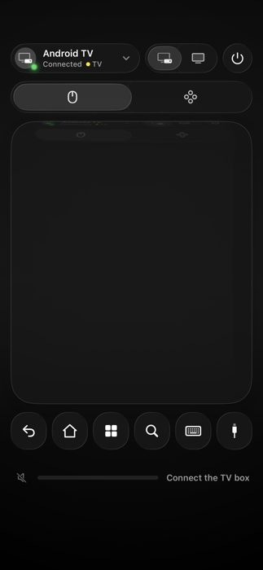 | "Connected" header beside "Connect the TV box" volume row (UX-001) |
| 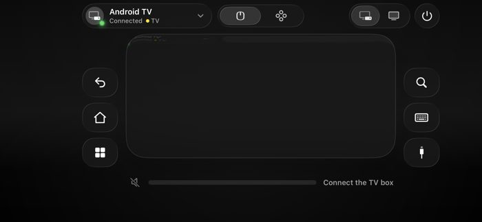 | Landscape console layout |
| 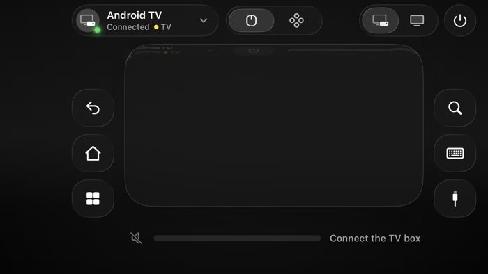 | 667×375 pt canvas fits |
| 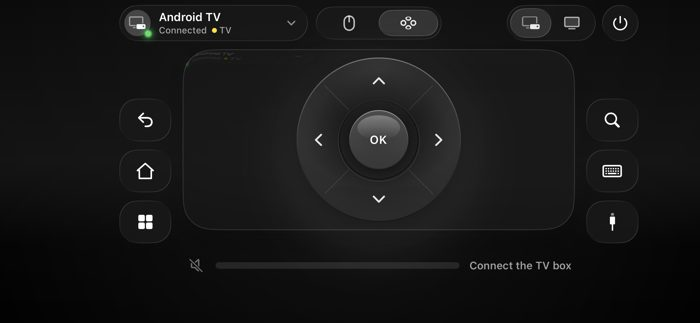 | D-pad mode |
| 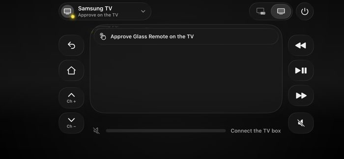 | Approval banner; volume row still follows box output (UX-003) |
| 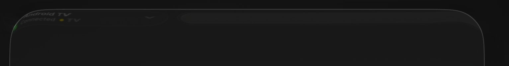 | Ghosted header inside trackpad edge (VIS-001) |
| 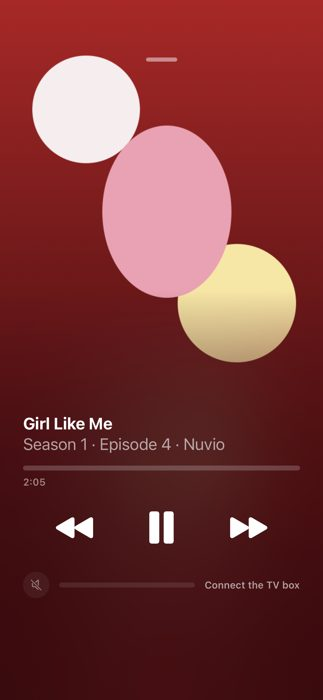 | Empty timeline track, elapsed only (UX-013) |
| 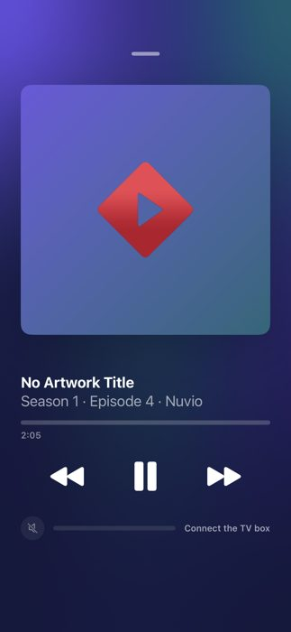 | No-artwork state |
| 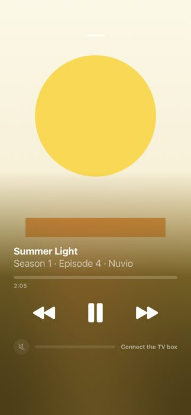 | Bright artwork legibility |
| 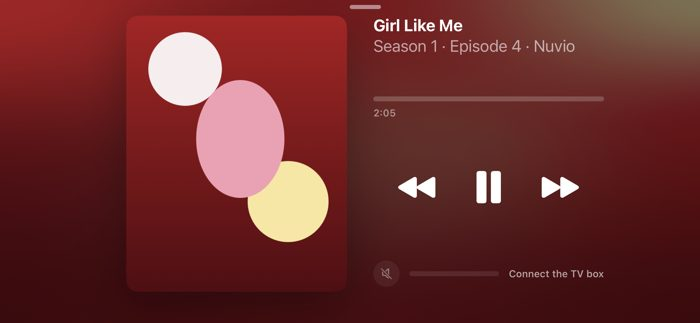 | Landscape card + column |
| 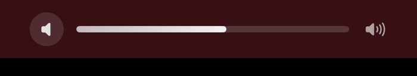 | Filled bar on a relative route (UX-002) |
| 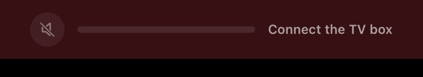 | Unavailable with reason |

### E. Commands used
```
gh pr view 8 --json title,body,state,baseRefName,headRefName,commits
gh run list --branch Phase-9-gap-fixes -L 5
gh run view 43253199439 --json jobs
gh run download 43253199439 -n glassremote-nowplaying-screens
gh run download 43253199439 -n ci-logs-test
grep -oE "Executed [0-9]+ tests?, with [0-9]+ failures" unit-tests.log   # → 540 tests, 0 failures
grep "warning:" simulator-build.log                                       # → 8 warnings
rg / sed over GlassRemote/ and Tests/ for the symbols cited above
```
No build, test or device command was run locally (no Xcode available).
